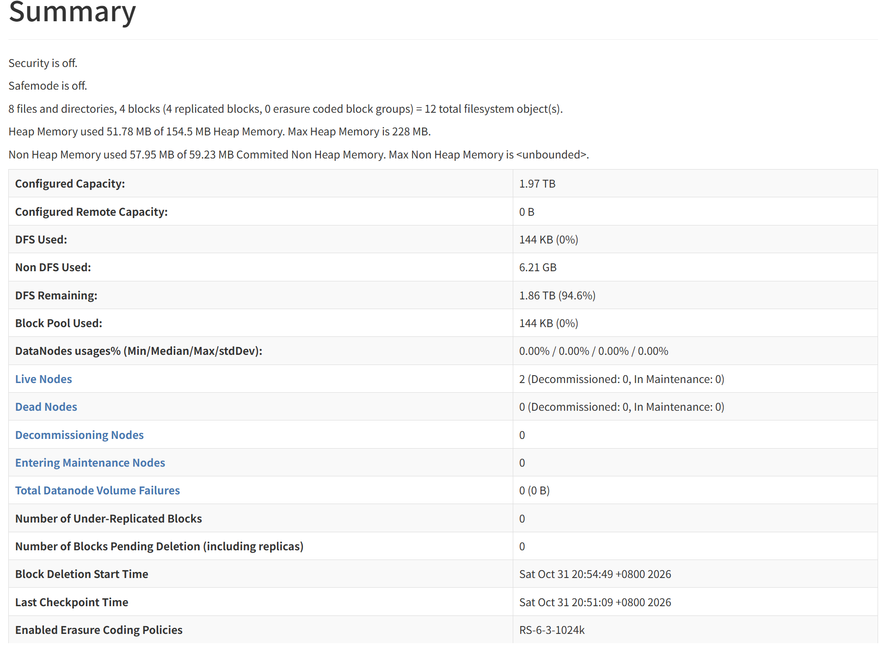
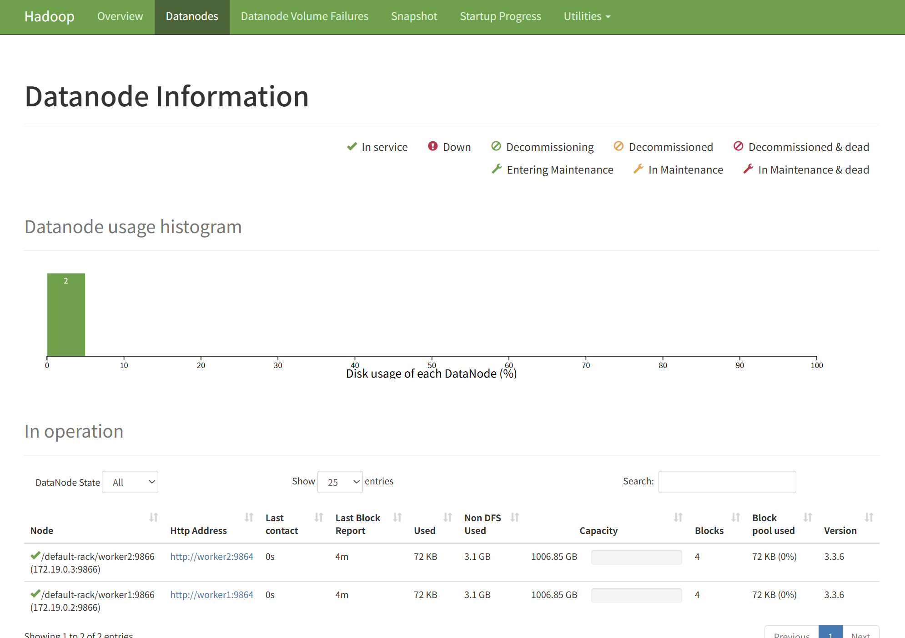
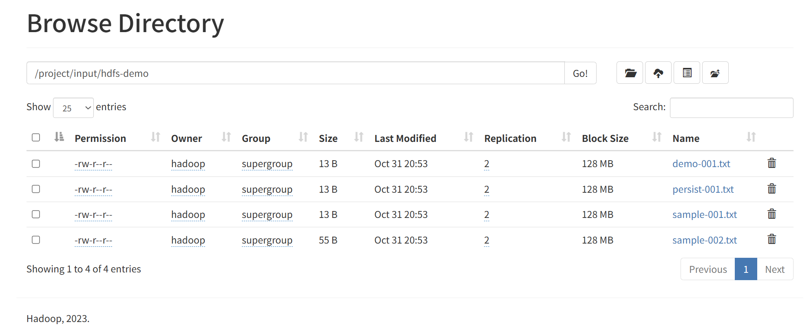
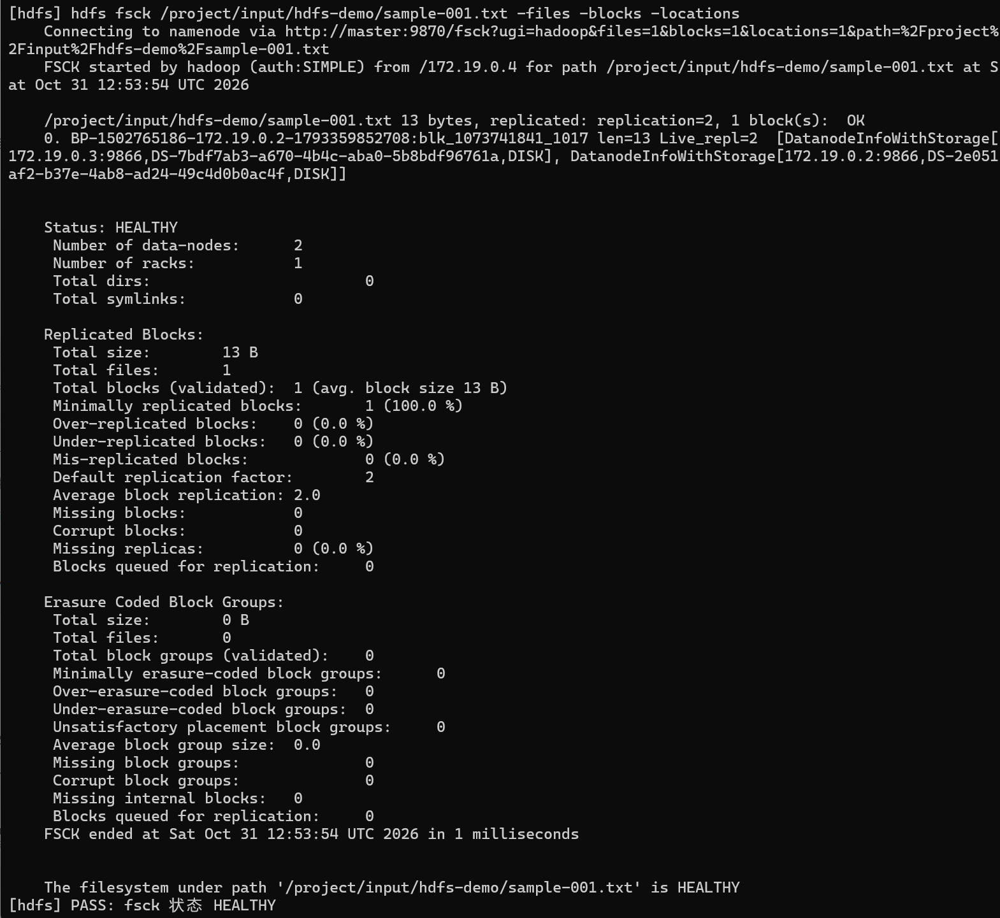
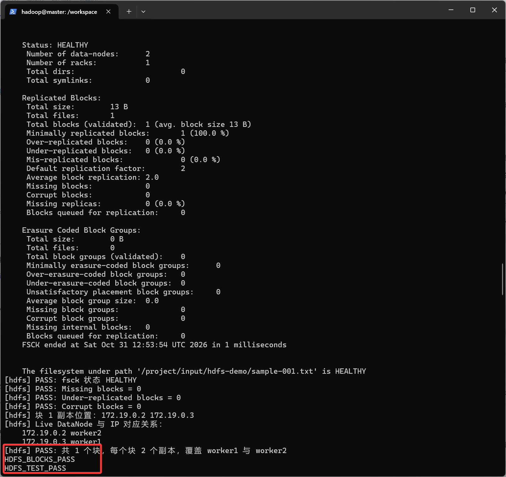
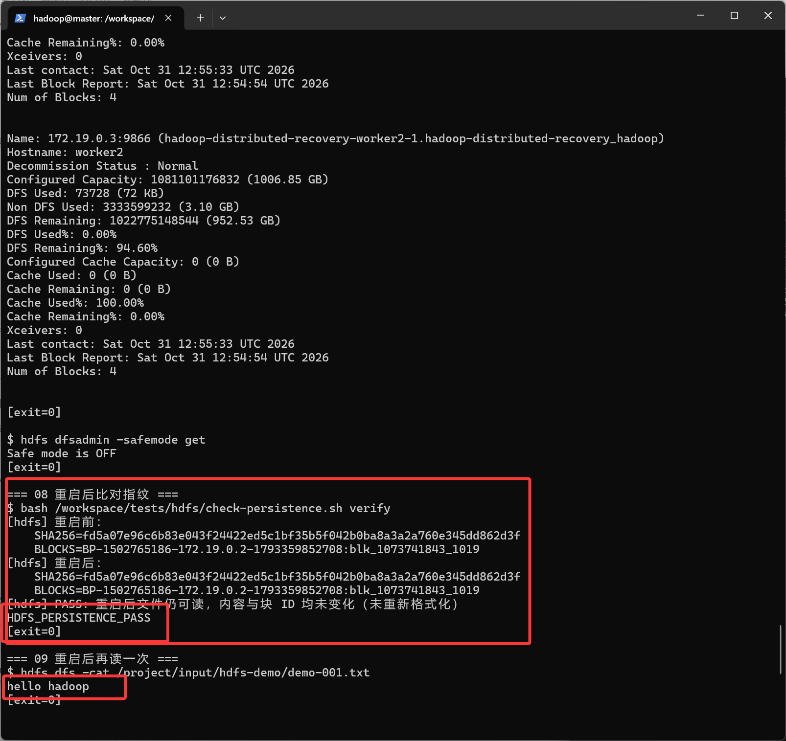
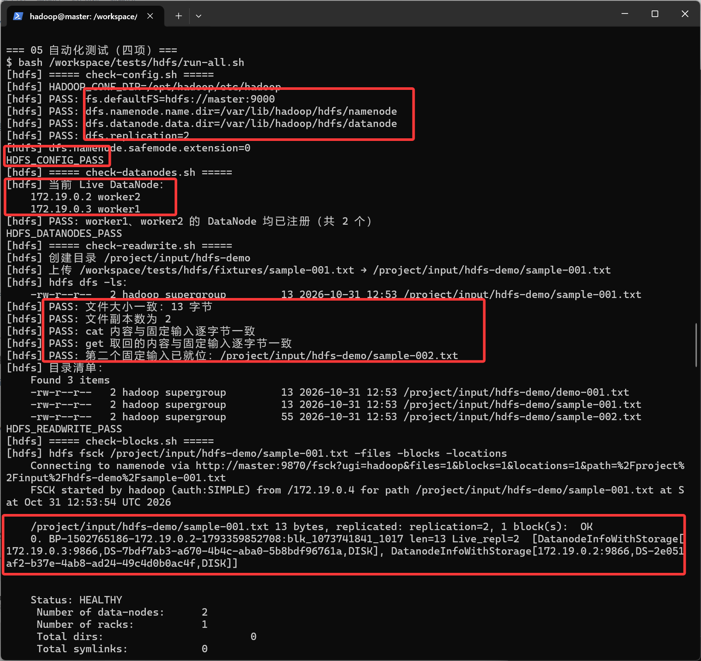

# 3 号 HDFS 模块 · 实测记录

> 验证日期 2026-10-31 20:53–20:56（本机时间）。容器内时钟为 UTC，所以原始输出里的时间戳是 12:53–12:55（相差 8 小时）。
> 执行环境：Windows 工作站 + Docker Desktop（Linux 容器），Compose 项目名 `hadoop-distributed-recovery`。
>
> **一句话结论**：两个 DataNode 均已注册；文件写入读回内容一致、副本数 2；`fsck` 显示每块两份副本分别落在两个不同 DataNode 上、无缺块无损坏；容器删除重建后文件内容与块 ID 均未变。

相关文档：[HDFS 配置说明](../../../config/hdfs/README.md) · [测试脚本说明](../../../tests/hdfs/README.md) · [三节点编排](../../../compose/README.md) · [公共接口](../../interfaces.md)

---

## 1 验证环境

| 项             | 内容                                                                                                    |
| -------------- | ------------------------------------------------------------------------------------------------------- |
| 验证日期       | 2026-10-31 20:53–20:56（本地时间）                                                                      |
| 执行人         | 3 号                                                                                                    |
| 机器 / 系统    | Windows 工作站，Docker Desktop 跑 Linux 容器                                                            |
| 镜像           | `hadoop-base:v0.1`（`.development` 固定）                                                               |
| Java           | 1.8.0_442（镜像固定，公共 verify 已验）                                                                 |
| Hadoop         | **3.3.6**（`hdfs version` 输出）                                                                        |
| Compose 项目名 | `hadoop-distributed-recovery`                                                                           |
| 代码提交号     | **`3d35f37`**（main，工作区干净）                                                                       |
| 证据           | 原始输出 14 个文本见 [evidence/](evidence/README.md)；截图 7 张见 [screenshots/](screenshots/README.md) |

---

## 2 集群拓扑

| 容器    | 承担服务                  | 数据目录（持久卷内）            | 卷             |
| ------- | ------------------------- | ------------------------------- | -------------- |
| master  | NameNode、ResourceManager | `/var/lib/hadoop/hdfs/namenode` | `master-data`  |
| worker1 | DataNode、NodeManager     | `/var/lib/hadoop/hdfs/datanode` | `worker1-data` |
| worker2 | DataNode、NodeManager     | `/var/lib/hadoop/hdfs/datanode` | `worker2-data` |

单 NameNode、非 HA；三个容器在同一 Docker 网络，逻辑上属于同一"机架"（见第 6 节的边界说明）。

---

## 3 配置项与生效值

| 配置项                            | 值                              | 作用                                 | 生效验证                           |
| --------------------------------- | ------------------------------- | ------------------------------------ | ---------------------------------- |
| `fs.defaultFS`                    | `hdfs://master:9000`            | 集群入口，NameNode RPC               | `hdfs getconf -confKey` 返回同名值 |
| `dfs.namenode.name.dir`           | `/var/lib/hadoop/hdfs/namenode` | 元数据目录，落持久卷                 | 同上                               |
| `dfs.datanode.data.dir`           | `/var/lib/hadoop/hdfs/datanode` | 块数据目录，落持久卷                 | 同上                               |
| `dfs.replication`                 | `2`                             | 每块两份，两个 worker 各一份         | 同上                               |
| `dfs.blocksize`                   | `134217728`（128 MB，未改默认） | 块大小                               | 同上                               |
| `dfs.namenode.safemode.extension` | `0`                             | 报块完成即离开安全模式，不空等 30 秒 | `getconf` 输出 `0`                 |

`core-site.xml` 另设 `hadoop.tmp.dir=/var/lib/hadoop/tmp`（容器 `/tmp` 重建即丢，改到卷内）、`io.file.buffer.size=131072`；`hdfs-site.xml` 另设 `dfs.namenode.http-address=0.0.0.0:9870`。

**挂载方式**：两份 XML 由编排**逐文件**只读挂到三个容器的 `/opt/hadoop/etc/hadoop/`，不整目录覆盖（整目录会盖掉 4 号的 YARN 配置）。容器内 `cat` 到的文件仍带着仓库版本的中文注释，证明挂载的是仓库文件，不是镜像里的空默认配置。

---

## 4 实测记录

### 4.1 配置生效

```text
$ hdfs getconf -confKey fs.defaultFS
hdfs://master:9000
$ hdfs getconf -confKey dfs.namenode.name.dir
/var/lib/hadoop/hdfs/namenode
$ hdfs getconf -confKey dfs.datanode.data.dir
/var/lib/hadoop/hdfs/datanode
$ hdfs getconf -confKey dfs.replication
2
```

结论：四项与公共契约（`.development`）完全一致。`getconf` 读的是 Hadoop 解析后的生效值，不是文件文本，因此能证明配置真的被加载。

原始输出：[`evidence/01-config.txt`](evidence/01-config.txt)

### 4.2 两个 DataNode 注册

```text
$ hdfs dfsadmin -report
Live datanodes (2):

Name: 172.19.0.2:9866 (...-worker2-1...)
Hostname: worker2
...
Name: 172.19.0.3:9866 (...-worker1-1...)
Hostname: worker1

$ hdfs dfsadmin -safemode get
Safe mode is OFF
```

结论：两个 Live DataNode，hostname 分别为 worker1、worker2；安全模式已关闭，集群可读写。上传前两台节点的 `Num of Blocks` 均为 0。

原始输出：[`evidence/02-datanodes.txt`](evidence/02-datanodes.txt)、[`evidence/02-safemode.txt`](evidence/02-safemode.txt)





### 4.3 读写与内容一致

```text
$ hdfs dfs -put -f /tmp/hdfs-demo/demo-001.txt /project/input/hdfs-demo/demo-001.txt
$ hdfs dfs -ls -h /project/input/hdfs-demo/demo-001.txt
-rw-r--r--   2 hadoop supergroup   13 2026-10-31 12:53 /project/input/hdfs-demo/demo-001.txt
$ hdfs dfs -cat /project/input/hdfs-demo/demo-001.txt
hello hadoop
$ hdfs dfs -stat "%b %r %o" /project/input/hdfs-demo/demo-001.txt
13 2 134217728
```

结论：上传成功；`ls` 第二列 `2` 即副本数；`cat` 读回内容与写入一致；`stat` 三个数分别是 13 字节、副本 2、块大小 128 MB。自动检查里还有 `get` 取回后逐字节 `cmp` 比对。

原始输出：[`evidence/03-readwrite.txt`](evidence/03-readwrite.txt)



### 4.4 块与副本位置

```text
$ hdfs fsck /project/input/hdfs-demo/demo-001.txt -files -blocks -locations
/project/input/hdfs-demo/demo-001.txt 13 bytes, replicated: replication=2, 1 block(s):  OK
0. BP-1502765186-172.19.0.2-1793359852708:blk_1073741840_1016 len=13 Live_repl=2
   [DatanodeInfoWithStorage[172.19.0.2:9866,...], DatanodeInfoWithStorage[172.19.0.3:9866,...]]
Status: HEALTHY
 Number of data-nodes:	2
 Number of racks:		1
 Under-replicated blocks:	0 (0.0 %)
 Missing blocks:		0
 Corrupt blocks:		0
 Default replication factor:	2
 Average block replication:	2.0
```

结论：13 字节文件占 1 个块，`Live_repl=2`，两个副本分别落在 `172.19.0.2` 与 `172.19.0.3` 两台不同 DataNode 上；状态 HEALTHY，缺块 / 欠副本 / 损坏块均为 0。

**副本 IP 与 hostname 的对应关系（重启前这一轮）**：

| 副本 IP    | hostname |
| ---------- | -------- |
| 172.19.0.2 | worker2  |
| 172.19.0.3 | worker1  |


原始输出：[`evidence/04-fsck.txt`](evidence/04-fsck.txt)（`demo-001.txt`）、[`evidence/05-run-all.txt`](evidence/05-run-all.txt)（其中 `sample-001.txt` 的同类检查）





### 4.5 重启持久化

| 步骤           | 命令                                            | 结果                                                                  |
| -------------- | ----------------------------------------------- | --------------------------------------------------------------------- |
| 重启前记录指纹 | `check-persistence.sh record`                   | `SHA256=fd5a07e9…862d3f`，`BLOCKS=…:blk_1073741843_1019`              |
| 停止并删除容器 | `docker compose … down`（**不加** `--volumes`） | 容器删除，三个命名卷保留                                              |
| 重新启动       | `docker compose … up -d`                        | 未执行任何格式化                                                      |
| 重启后注册     | `dfsadmin -report`                              | `Live datanodes (2)`，两台 `Num of Blocks` 均为 4；`Safe mode is OFF` |
| 比对指纹       | `check-persistence.sh verify`                   | 前后完全一致 → `HDFS_PERSISTENCE_PASS`，退出码 0                      |
| 再读一次       | `hdfs dfs -cat …/demo-001.txt`                  | `hello hadoop`                                                        |

```text
重启前 SHA256=fd5a07e96c6b83e043f24422ed5c1bf35b5f042b0ba8a3a2a760e345dd862d3f
重启后 SHA256=fd5a07e96c6b83e043f24422ed5c1bf35b5f042b0ba8a3a2a760e345dd862d3f
重启前 BLOCKS=BP-1502765186-172.19.0.2-1793359852708:blk_1073741843_1019
重启后 BLOCKS=BP-1502765186-172.19.0.2-1793359852708:blk_1073741843_1019
```

结论：内容 SHA256 与块 ID 双双未变，说明 NameNode 没有重新格式化、块也没有被重建，数据确实落在持久卷上。只比内容不够（重传一份内容相同的文件也会得到相同哈希），块 ID 才能证明"是同一个块"。

补充：9870 的 Browse 页面在重启之后仍能看到这些文件，`Last Modified` 为重启前的 20:53。

原始输出：[`evidence/06-persistence-record.txt`](evidence/06-persistence-record.txt)、[`evidence/07-datanodes-after.txt`](evidence/07-datanodes-after.txt)、[`evidence/07-safemode-after.txt`](evidence/07-safemode-after.txt)、[`evidence/08-persistence-verify.txt`](evidence/08-persistence-verify.txt)、[`evidence/09-cat-after.txt`](evidence/09-cat-after.txt)



### 4.6 自动化测试

```text
$ bash /workspace/tests/hdfs/run-all.sh
HDFS_CONFIG_PASS        ← 配置四项
HDFS_DATANODES_PASS     ← Live DataNode = 2，含 worker1、worker2
HDFS_READWRITE_PASS     ← 大小 13 字节、副本 2、cat/cmp 一致
HDFS_BLOCKS_PASS        ← 每块 2 副本，覆盖两个 worker
HDFS_TEST_PASS
[exit=0]
```

结论：四项检查全部通过，退出码 0。脚本可反复执行（`put -f` 覆盖同名文件，断言只依赖当次内容）。

**失败用例本次未做**，见第 6 节。

原始输出：[`evidence/05-run-all.txt`](evidence/05-run-all.txt)




---

## 5 如何复现

在电脑终端、项目根目录，使用同一个 Compose 项目名：

```powershell
docker compose --env-file .development -p hadoop-distributed-recovery -f compose/distributed.yaml up -d
docker compose --env-file .development -p hadoop-distributed-recovery -f compose/distributed.yaml exec -T master hdfs dfsadmin -report
docker compose --env-file .development -p hadoop-distributed-recovery -f compose/distributed.yaml exec master bash
```

容器内：

```bash
bash /workspace/tests/hdfs/run-all.sh
bash /workspace/tests/hdfs/check-persistence.sh record
exit
```

回到电脑终端做不删卷重启，再进容器验证：

```powershell
docker compose --env-file .development -p hadoop-distributed-recovery -f compose/distributed.yaml down
docker compose --env-file .development -p hadoop-distributed-recovery -f compose/distributed.yaml up -d
docker compose --env-file .development -p hadoop-distributed-recovery -f compose/distributed.yaml exec master bash
```

```bash
bash /workspace/tests/hdfs/check-persistence.sh verify
```

预期：`HDFS_TEST_PASS`、`HDFS_PERSISTENCE_PASS`，退出码均为 0。

---

